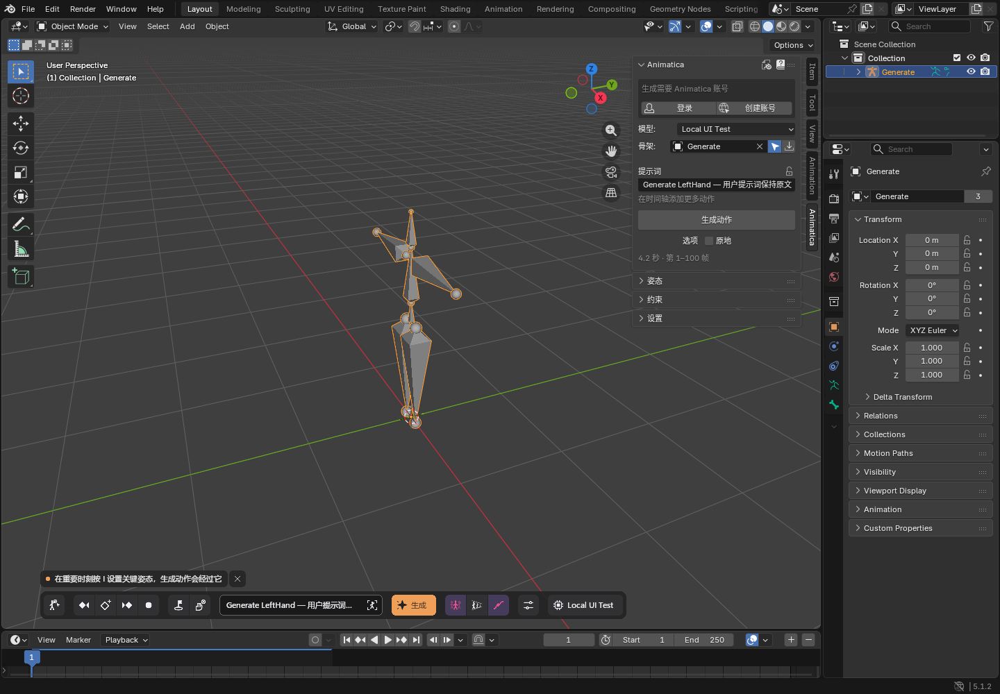
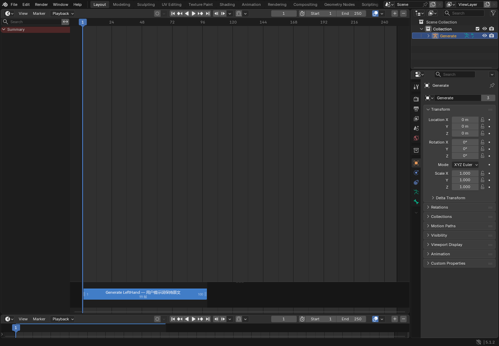
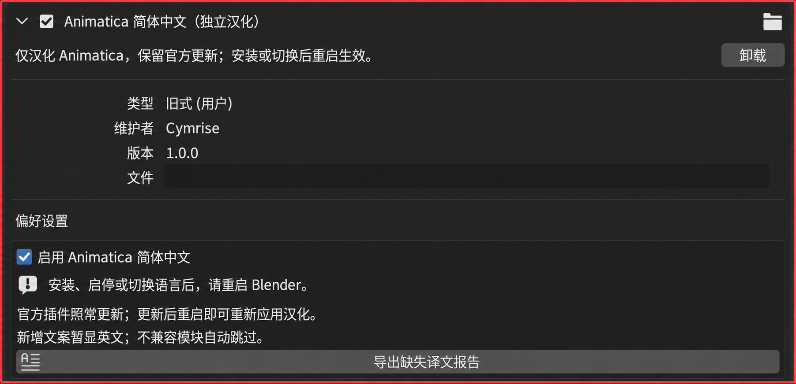

# Animatica Blender 汉化插件

让 **Animatica 显示简体中文，同时保留官方更新流程**。这是独立的汉化伴随插件，不需要把整个 Blender 改成中文。

本项目为非官方社区汉化，与 Animatica 官方无隶属关系。使用前需要单独安装 [Animatica 官方插件](https://github.com/animatica-ai/animatica-blender-plugin)。本仓库不包含官方插件、模型或账号信息。

汉化包维护者：**Cymrise**。

**[⬇ 一键下载最新版汉化安装包](https://github.com/BearCubConstellation/Animatica_Blender_zh_CN/releases/latest/download/Animatica_zh_CN.zip)** · **[版本说明与下载页](https://github.com/BearCubConstellation/Animatica_Blender_zh_CN/releases/latest)**

下载 ZIP 后，在 Blender 中选择 **Install from Disk…** 安装，无需解压、下载源码或运行脚本。汉化包与官方插件需要分别安装。

## 效果预览

下图为此前 0.7.0-preview3 的独立测试配置实拍，用于展示汉化效果；新版 1.0.4 的布局和按钮有所调整。Blender 菜单仍为英文，Animatica 面板和浮动工具栏显示中文。



时间轴中的界面提示显示中文；用户输入的提示词和对象名称保留原文。



## 支持情况

| 项目 | 当前状态 |
| --- | --- |
| 汉化包版本 | 1.1.0 |
| 已验证系统 | Windows |
| 已验证 Blender | 5.1.2（面向 5.1 系列） |
| 已验证 Animatica | Choreographer 1.0.4；已测试从 0.7.0-preview3 升级 |
| 译文词条 | 1530 条 |
| 静态扫描结果 | 1.0.4 中识别的 895 条界面文案均已收录 |
| 中文字体 | 使用系统中已有的中文字体，不随包分发字体 |

静态覆盖率只代表扫描器识别到的文案，不代表所有运行时场景均已验证。其他系统、Blender 版本及未来 Animatica 版本需要额外验证。

本次新增工具栏折叠、复制/粘贴动作、多角色生成和审阅等文案。官方 1.0 起将手动姿态编辑拆分为独立的 **Animatica Marionette**，该独立插件的内部界面不在本次汉化范围内。

## 可以汉化哪些内容

- 按钮、菜单、设置项、操作说明、工具提示和插件自身状态提示。
- 浮动工具栏、时间轴等自绘界面的显示文字。
- 自绘文字使用中文字体，并让文字测量、截断和绘制使用相同字体。

以下内容保留原文：用户提示词、对象名、骨骼名、文件路径、接口参数、内部标识和原始错误详情。服务器直接返回的未知文字也可能显示英文。

## 下载与安装

### 1. 下载可安装包

点击 **[下载最新版安装包](https://github.com/BearCubConstellation/Animatica_Blender_zh_CN/releases/latest/download/Animatica_zh_CN.zip)**，得到 `Animatica_zh_CN.zip`。

也可打开 **[Releases 下载页](https://github.com/BearCubConstellation/Animatica_Blender_zh_CN/releases/latest)**，在 **Assets** 下下载安装包、中文安装说明或 `SHA256SUMS.txt` 校验文件。`Animatica_zh_CN.zip` 与同版本的 `Animatica_简体中文_1.1.0.zip` 内容相同，任选一个即可。

请使用这个插件 ZIP 安装。GitHub 页面绿色 **Code → Download ZIP** 下载的是整个源码工程，不能直接作为插件安装。

### 2. 在 Blender 中安装

1. 先安装并启用官方 Animatica 插件。
2. 打开 **Edit → Preferences → Add-ons**（编辑 → 偏好设置 → 插件）。
3. 在插件页面右上方菜单中选择 **Install from Disk…**（从磁盘安装）。
4. 选择下载好的 `Animatica_zh_CN.zip`，完成安装。
5. 搜索 `Animatica`，启用 **Animatica 简体中文（独立汉化）**。
6. 保存偏好设置，然后**完全关闭并重新启动 Blender**。

安装成功后，展开“Animatica 简体中文（独立汉化）”，确认已勾选“启用 Animatica 简体中文”，保存偏好设置并重启 Blender。



*上图保留汉化插件设置区域，并隐藏了本机文件路径。*

首次安装后必须重启。汉化需要在官方插件加载前生效，仅关闭并重新打开面板通常不够。

### 已安装旧版汉化包

先保存工作并关闭其他 Blender 窗口，再通过 **Install from Disk…** 安装新版汉化 ZIP，替换旧版。启用汉化、保存偏好设置并完全重启。展开插件后应显示版本 **1.1.0**。官方 Animatica 仍通过其自己的更新功能升级。

## 官方插件如何更新

照常使用 Animatica 官方提供的检查、下载和安装更新功能。更新完成后重启 Blender，汉化会重新应用。

汉化插件与官方插件分别存放：

```text
Blender 用户脚本目录/
├─ addons/
│  ├─ animatica_blender/          # 官方插件，仍由官方更新器管理
│  └─ animatica_zh_cn/            # 独立汉化包
└─ startup/
   └─ animatica_zh_bootstrap.py   # 提前加载汉化的启动入口
```

汉化开关另存在 Blender 用户配置目录的 `animatica_zh_cn.json` 中。

汉化包不改写官方源码、版本号或更新配置，也不将汉化后的代码写入官方缓存。官方新增且词库尚未收录的文字会显示英文；适配失败的模块会回退到官方加载方式，并记录提示。未来较大的结构变化可能需要新版汉化包，不能保证永久兼容。

## 开关汉化与卸载

### 暂时恢复英文

在偏好设置中展开 **Animatica 简体中文（独立汉化）**，取消勾选 **启用 Animatica 简体中文**，保存偏好设置并重启。重新勾选并重启即可恢复中文。

### 卸载

禁用或卸载汉化插件，保存偏好设置并重启。官方 Animatica 可继续使用。

如需清理剩余文件，可在关闭 Blender 后删除用户脚本目录中的 `startup/animatica_zh_bootstrap.py`，以及用户配置目录中的 `animatica_zh_cn.json`。禁用或卸载汉化包后，留下的启动入口不会主动加载汉化。

## 常见问题

**装完还是英文？**

确认官方插件和独立汉化插件都已启用、汉化开关已打开，并已保存偏好设置后完全重启 Blender。此包针对官方模块 `animatica_blender`，重命名官方目录会影响识别。

**为什么提示词、骨骼名没有变成中文？**

这些是用户数据或程序需要识别的名称，会有意保留原文。

**更新后出现部分英文？**

通常是官方新增文案尚未收录。可以导出缺失译文报告，提交到本仓库 Issues；报告可能包含本地路径或运行时错误，请检查后再公开上传。

**中文显示为方框？**

当前主要验证 Windows，默认优先使用系统中文字体。请先确认系统具有中文字体。其他系统的字体适配尚未完成验收。

**是否会改变其他插件？**

加载适配限定于 `animatica_blender` 及其子模块，并排除其 vendor 模块；字体代理也只注入被适配的模块。Blender 的全局语言和全局 `blf` 模块不会被替换。

## 检查缺失译文

### 在 Blender 中检查

展开汉化插件的偏好设置，点击 **导出缺失译文报告**，选择保存位置。报告含静态扫描结果及本次运行记录的不兼容模块。

### 使用命令行检查

无需启动 Blender，使用 Python 3.10 或更新版本运行：

```powershell
python animatica_zh_cn/check_missing.py "你的官方插件目录/animatica_blender" "animatica_missing_zh.json"
```

| 报告字段 | 含义 |
| --- | --- |
| `total` | 扫描器识别出的界面文案数 |
| `translated` | 已在词库中收录的数量 |
| `missing` | 未收录的英文及所在文件 |
| `scan_errors` | 扫描时出现的问题 |
| `runtime_skipped` | 当前进程中跳过适配的模块；命令行扫描通常为空 |

维护词库时编辑 `animatica_zh_cn/zh_CN.json`。英文键保持原样，中文值可修改；`{0}`、`{1}` 等占位符必须保留。扫描完成后仍需在 Blender 中检查实际显示效果。

## 开发与打包

```text
animatica_zh_cn/     插件源码、中文词库及许可证
docs/images/        README 中使用的真实测试截图
docs/验证说明.md     验收范围与限制
tests/              单元测试和隔离 Blender 测试脚本
tools/build.py      生成可安装 ZIP 和校验文件
tools/validate_blender.py  在临时配置中运行集成和重启测试
.github/workflows/release.yml  提交时测试打包，推送版本标签时自动发布安装包
dist/               可安装插件 ZIP、简短安装说明和 SHA-256 校验
LICENSE             GPL-3.0 许可证全文
```

使用 Python 3.10 或更新版本，在工程根目录执行：

```powershell
# 单元测试，不启动 Blender
python -m unittest discover -s tests -p "test_core.py" -v

# 打包；不安装或改写当前 Blender 环境
python tools/build.py

# 隔离测试：自行填写 Blender 和已安装官方插件的实际路径
python tools/validate_blender.py --blender "D:/Blender/Blender 5.1/blender.exe" --addon "你的官方插件目录/animatica_blender"

# 验证最终安装包；可选 --previous-addon "旧版插件目录/animatica_blender" 测试跨版本替换
python tools/validate_blender.py --blender "D:/Blender/Blender 5.1/blender.exe" --addon "新版插件目录/animatica_blender" --package "dist/Animatica_zh_CN.zip"
```

集成测试将官方插件复制到系统临时目录（避免官方更新器拒绝 Git 工程中的安装），再测试注册、语言切换、真实官方目录替换函数及三次重启。它不下载官方新版本，不启动云端生成，也不改变当前工作配置。测试结果写入 `.work/`，该目录不会提交到 Git。

维护者发布：更新插件版本、词库、本文及 `docs/release-notes.md`，通过测试后推送同名 `vX.Y.Z` 标签。GitHub Actions 会检查版本一致性、打包并将可安装 ZIP 上传到 Releases；普通提交也会测试和生成构建产物。

## 已完成的验证

- 13 项单元测试通过，包括用户数据保留、内部枚举标识保留、字体隔离、未知文案回退、适配失败回退、Python 注解语义、新版动态提示及全部译文占位符。
- 使用最终安装 ZIP，在隔离配置中调用官方更新器，验证 1.0.4 同版本替换及 0.7.0-preview3 → 1.0.4 跨版本替换，汉化包仍存在、汉化重新生效。
- 中文 → 英文 → 中文三个独立重启场景通过。
- 自动检查 1.0.4 的折叠工具栏、复制/粘贴动作标签与工具提示。本文 GUI 截图保留自此前版本，本轮未重新进行 GUI 验收。
- 新旧版官方源目录的文件内容哈希保持一致（忽略 Python 缓存）。

未验证在线更新下载、云端生成、Marionette 内部界面和所有 DPI/布局组合。更多说明见 [验证说明](docs/验证说明.md)。

## 许可证与来源

本汉化包源码和词库采用 **GPL-3.0-or-later**，详见 [LICENSE](LICENSE)。截图为测试配置实拍，展示了 Blender 和官方 Animatica 界面；各产品名称和商标属于各自权利人。本仓库不分发官方插件或第三方字体。

- [Animatica 官方插件仓库](https://github.com/animatica-ai/animatica-blender-plugin)
- [Blender 官方网站](https://www.blender.org/)

欢迎通过 Issues 提交缺失翻译、截图和版本信息。提交前请删除账号凭据、私人提示词和个人文件路径。
